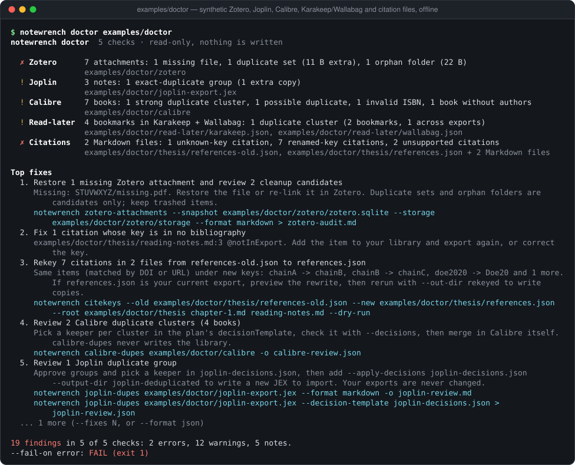

<p align="center">
  <picture>
    <source media="(prefers-color-scheme: dark)" srcset="assets/logo-dark.svg">
    
  </picture>
</p>

<p align="center">
  <strong>Dedupe, audit and migrate your Zotero, Joplin, Calibre, Logseq and Wallabag libraries, offline, without deleting a thing.</strong><br>
  One standard-library CLI. <code>notewrench doctor</code> checks everything in one read-only pass and tells you which command fixes what.
</p>

<p align="center">
  <a href="https://pypi.org/project/notewrench/"></a>
  <a href="https://pypi.org/project/notewrench/"></a>
  <a href="LICENSE"></a>
</p>

<p align="center">
  English · <a href="README.zh-CN.md">简体中文</a>
</p>

<p align="center">
  <strong>Match Joplin notes by title and 9 out of 10 "duplicates" are wrong. Compare body, attachment bytes and to-do state instead: all 120 real duplicate pairs, zero false alarms.</strong><br>
  <sub>240 synthetic notes in 40 labelled families (renamed copies, changed attachments, completed to-dos, different notes with the same title): title-only precision 0.100 and recall 0.333, <code>joplin-dupes</code> 1.000 and 1.000. <a href="benchmarks/joplin-dupes/results.json">Stored result</a> · <a href="docs/joplin-dupes.md#reproducible-benchmark">method</a> · reproduce with <code>python3 benchmarks/joplin-dupes/benchmark.py --families 40 --repeats 3</code>.</sub>
</p>

```sh
uvx notewrench doctor ~/exports        # or: pipx install notewrench  /  pip install notewrench
```

<p align="center">
  
</p>
<p align="center"><sub>Real output on the bundled synthetic sample (<code>examples/doctor</code>, fictional data, no network). Regenerate with <code>assets/render_terminal.py</code>.</sub></p>

## Quick start

`doctor` takes any mix of exports, libraries and folders. It works out what each one is,
runs the read-only analysis of the command that owns that kind of data, and never writes
anything:

```sh
uvx notewrench doctor ~/Zotero "$HOME/Calibre Library"    # close Zotero and Calibre first, or use copies
uvx notewrench doctor joplin.jex karakeep.json wallabag.json
uvx notewrench doctor thesis/ --fail-on warning           # CSL-JSON + Markdown, as a pre-submission gate
```

To run the demo above from a clone:

```sh
git clone https://github.com/tianhaogutum/notewrench && cd notewrench
uvx notewrench doctor examples/doctor
```

Exit status: `0` nothing at or above `--fail-on` (default `error`), `1` findings at or above
it, `2` usage error, unrecognized path or unreadable source. `--format json` prints a
`notewrench.doctor/v1` document. Details: [docs/doctor.md](docs/doctor.md).

## What it handles

| App | notewrench reads | `doctor` reports | To fix or move it |
| --- | --- | --- | --- |
| **Zotero** | a closed `zotero.sqlite` copy + `storage/`; CSL-JSON exports | missing attachment files, byte-identical duplicates, orphan storage folders (Linux) | `zotero-attachments`, `zotero-logseq` |
| **Joplin** | JEX exports and raw export folders | exact-duplicate notes, ID conflicts between exports, notes that cannot be compared | `joplin-dupes`, `joplin-logseq` |
| **Calibre** | a closed library (`metadata.db`) | duplicate books (ISBN, normalized title and authors), invalid ISBNs, missing authors | `calibre-dupes` |
| **Karakeep / Wallabag** | Karakeep JSON and Wallabag v2 exports | duplicate bookmarks within and across exports, invalid records | `links`, `archive`, `epub`, `wallabag-notes` |
| **Pandoc / Better BibTeX** | CSL-JSON bibliographies + Markdown | citekeys in no bibliography, keys renamed between exports, unsupported citation syntax | `citekeys` |
| **Logseq** | an existing Markdown graph (as a target) | | `zotero-logseq`, `joplin-logseq`, `wallabag-notes` |

## All commands

| | Command | What it does | Docs |
| --- | --- | --- | --- |
| **Check** | `doctor` | One read-only health check across all of the above, with the command that fixes each problem | [doctor](docs/doctor.md) |
| **Migrate & sync notes** | `zotero-logseq` | Sync a Zotero CSL-JSON export into Logseq pages; bibliographic updates never touch your own notes | [zotero-logseq](docs/zotero-logseq.md) |
| | `joplin-logseq` | Convert a Joplin JEX export into a new Logseq Markdown graph, with an audit/loss report | [joplin-logseq](docs/joplin-logseq.md) |
| | `wallabag-notes` | Export Wallabag highlights and annotations to Markdown, Logseq blocks and CSV, and keep them updated | [wallabag-notes](docs/wallabag-notes.md) |
| **Read-later archives** | `archive` | Rescue cached Wallabag/Karakeep articles into a static HTML archive; convert Karakeep exports to Wallabag JSON | [archive](docs/archive.md) |
| | `epub` | Bundle cached Wallabag/Karakeep articles into a validated EPUB 3 with a provenance report | [epub](docs/epub.md) |
| **Duplicates** | `links` | Find duplicate bookmarks across Karakeep and Wallabag exports and plan a reviewed merge | [links](docs/links.md) |
| | `joplin-dupes` | Review duplicate notes in Joplin exports and write an approved, deduplicated JEX copy | [joplin-dupes](docs/joplin-dupes.md) |
| | `calibre-dupes` | Find duplicate books within or across Calibre libraries and plan which formats to keep | [calibre-dupes](docs/calibre-dupes.md) |
| **Citations & attachments** | `citekeys` | Rewrite Pandoc citekeys in Markdown when your CSL-JSON keys change, matched by DOI or URL | [citekeys](docs/citekeys.md) |
| | `zotero-attachments` | Audit a Zotero snapshot for duplicate, missing and orphaned attachment files, and compare audits | [zotero-attachments](docs/zotero-attachments.md) |

`notewrench <command> --help` lists every option. Every command has runnable synthetic
inputs in `examples/<command>/`; the commands below run from a clone.

## Quick start by group

### Migrate & sync notes

```sh
notewrench zotero-logseq examples/zotero-logseq/library.json --graph ./my-graph --dry-run
notewrench joplin-logseq examples/joplin-logseq/synthetic.jex my-new-logseq-graph   # a new graph + report.json
notewrench wallabag-notes examples/wallabag-notes/wallabag-v2.json --output notes
```

### Read-later archives

```sh
notewrench archive rescue examples/archive/wallabag-v2.json -o archive               # Linux
notewrench epub build examples/epub/wallabag.json --title "Weekend reading" -o reading.epub --report report.json
notewrench epub validate reading.epub
```

### Duplicates

```sh
notewrench links --out review examples/links/karakeep.json examples/links/wallabag-v2.json
notewrench joplin-dupes examples/joplin-dupes/synthetic.jex --format markdown
python3 examples/calibre-dupes/synthetic.py sample .demo
notewrench calibre-dupes .demo/library-a .demo/library-b -o .demo/clusters.json
```

### Citations & attachments

```sh
notewrench citekeys --old examples/citekeys/old.json --new examples/citekeys/new.json examples/citekeys/paper.md
notewrench zotero-attachments --snapshot examples/zotero-attachments/synthetic/zotero.sqlite \
  --storage examples/zotero-attachments/synthetic/storage --format markdown            # Linux
```

## Safety

- **Offline, no accounts, no telemetry.** No command opens a network connection or
  calls an app API. Everything works on files you exported or copied.
- **Read-only by default.** `doctor`, `zotero-attachments` and `calibre-dupes` only
  read. `joplin-dupes` and `citekeys` (its default `--dry-run`) print reviews.
  `links --dry-run`, `zotero-logseq --dry-run`, `joplin-logseq --dry-run` and
  `wallabag-notes --dry-run` show what would be written.
- **Never edits a live app database.** Nothing writes to `zotero.sqlite`, Calibre's
  `metadata.db` or Joplin's profile. The Zotero and Calibre readers open the database
  read-only and refuse one that has `-wal`/`-journal` sidecar files next to it. Close the
  app first, or work on a copy.
- **New files, not overwrites.** Outputs go to a new file or directory. An existing
  path is refused, and duplicates are only merged after you approve them in a decision
  file: `joplin-dupes` writes a *new* JEX for you to import, and `links --wallabag-export`
  writes a *new* Wallabag export.
- **Your own notes stay yours.** `zotero-logseq` rewrites only the hash-checked region it
  owns in each Logseq page and never deletes pages. `wallabag-notes --update` rewrites only the
  files it manages, and refuses if you edited them.
- **Candidates are labelled as candidates.** Same URL, same title or same ISBN is
  evidence, not proof. Reports keep provenance and conflicts so you can decide.

## How it compares

notewrench works on exports and closed copies, outside the apps, and leaves the final
merge to you or to the app itself. It complements the built-in tools rather than
replacing them.

| You use | It does | notewrench adds |
| --- | --- | --- |
| Zotero's **Duplicate Items** pane | Merges duplicate *items* by metadata inside the running app | `zotero-attachments` audits the *files*: byte-identical attachments, missing files and orphan `storage/` folders, from a closed copy, with JSON evidence and before/after comparison |
| **Better BibTeX** | Generates stable citekeys and keeps CSL-JSON/BibTeX exports current | `citekeys` rewrites the `[@key]` citations already in your Markdown when keys change, matched by DOI or URL. `doctor` finds citekeys that no export contains |
| Calibre's **Find Duplicates** plugin | Interactive duplicate search inside Calibre, including against another library | `calibre-dupes` is scriptable and read-only on a closed library, with ISBN-checksum validation, evidence levels and a JSON plan of which formats to keep. You still merge in Calibre |
| Joplin's **import/export** (JEX, RAW, Markdown) | Moves notes in and out of Joplin | `joplin-dupes` compares exports by content and attachment bytes before you re-import, and `joplin-logseq` converts JEX into a Logseq graph with a loss report |
| **Logseq** importers and Zotero integration | Imports Roam JSON, OPML and Logseq's own formats. The Zotero integration uses the Zotero web API | Offline conversion from Joplin JEX, Zotero CSL-JSON and Wallabag exports that keeps your own notes intact on re-sync |
| **Karakeep / Wallabag** exports | JSON (and other formats) of your bookmarks and cached articles | Duplicate detection *across* both apps with tracking-parameter normalization, plus HTML archives and validated EPUBs built from the cached copies |

## Platform support

Python 3.11 to 3.14 on **Linux and macOS**, standard library only (no third-party
dependencies). **Windows is not supported.** Two parts need Linux:
`notewrench archive` publication and verification, and the `zotero-attachments` audit
(`zotero-attachments compare` runs on macOS too). On macOS, `doctor` reports the Zotero
check as `SKIPPED` and runs the rest. Several commands refuse paths reached through
symlinks, and on macOS `/tmp` is one, so use a folder under your home directory.

notewrench is independent and not affiliated with Zotero, Better BibTeX, Joplin, Logseq,
Calibre, Wallabag or Karakeep. Interoperability references and attributions:
[THIRD_PARTY.md](THIRD_PARTY.md).

## License

AGPL-3.0-only. See [LICENSE](LICENSE).

---

<p align="center">If notewrench found a duplicate or a missing attachment before you lost it, a star helps other people find it too.</p>
