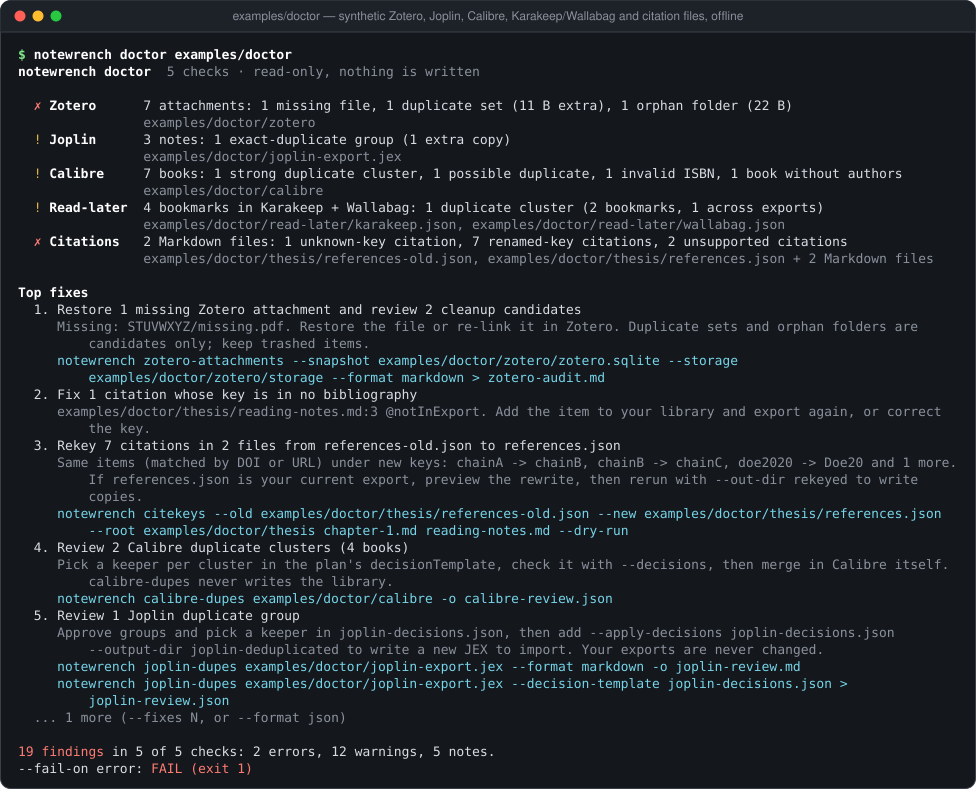

<p align="center">
  <picture>
    <source media="(prefers-color-scheme: dark)" srcset="assets/logo-dark.svg">
    
  </picture>
</p>

<p align="center">
  <strong>给 Zotero、Joplin、Calibre、Logseq 和 Wallabag 资料库去重、体检、迁移：全程离线，一个文件都不删。</strong><br>
  只依赖 Python 标准库的命令行工具。<code>notewrench doctor</code> 一次只读扫描全部资料，并告诉你每个问题该用哪条命令修。
</p>

<p align="center">
  <a href="https://pypi.org/project/notewrench/"></a>
  <a href="https://pypi.org/project/notewrench/"></a>
  <a href="LICENSE"></a>
</p>

<p align="center">
  <a href="README.md">English</a> · 简体中文
</p>

<p align="center">
  <strong>按标题找 Joplin 重复笔记，十个“重复”里有九个是错的。改为比对正文、附件字节和待办状态：120 对真重复全部找到，零误报。</strong><br>
  <sub>40 组带标注的合成数据、共 240 条笔记（改名副本、附件被改、待办已完成、同名但内容不同）：仅按标题的精确率 0.100、召回率 0.333，<code>joplin-dupes</code> 均为 1.000。<a href="benchmarks/joplin-dupes/results.json">存档结果</a> · <a href="docs/joplin-dupes.md#reproducible-benchmark">方法</a> · 复现：<code>python3 benchmarks/joplin-dupes/benchmark.py --families 40 --repeats 3</code>。</sub>
</p>

```sh
uvx notewrench doctor ~/exports        # 或：pipx install notewrench  /  pip install notewrench
```

<p align="center">
  
</p>
<p align="center"><sub>在仓库自带的合成样例（<code>examples/doctor</code>，虚构数据，不联网）上的真实输出。用 <code>assets/render_terminal.py</code> 重新生成。</sub></p>

## 快速上手

`doctor` 可以接收任意组合的导出文件、资料库和文件夹。它会识别每个路径是什么，调用负责该类数据的命令做只读分析，全程不写任何文件：

```sh
uvx notewrench doctor ~/Zotero "$HOME/Calibre Library"    # 先关闭 Zotero 和 Calibre，或者用副本
uvx notewrench doctor joplin.jex karakeep.json wallabag.json
uvx notewrench doctor thesis/ --fail-on warning           # CSL-JSON + Markdown，交稿前把关
```

在克隆的仓库里运行上面的演示：

```sh
git clone https://github.com/tianhaogutum/notewrench && cd notewrench
uvx notewrench doctor examples/doctor
```

退出码：`0` 没有达到 `--fail-on`（默认 `error`）级别的问题；`1` 有达到该级别的问题；`2` 用法错误、无法识别的路径或读不了的来源。`--format json` 输出 `notewrench.doctor/v1` 文档。详见 [docs/doctor.md](docs/doctor.md)。

## 支持哪些应用

| 应用 | notewrench 读取 | `doctor` 报告 | 修复或迁移用 |
| --- | --- | --- | --- |
| **Zotero** | 已关闭的 `zotero.sqlite` 副本 + `storage/`；CSL-JSON 导出 | 缺失的附件文件、字节完全相同的重复文件、孤立的 storage 文件夹（Linux） | `zotero-attachments`、`zotero-logseq` |
| **Joplin** | JEX 导出和 RAW 导出文件夹 | 完全重复的笔记、多份导出之间的 ID 冲突、无法比对的笔记 | `joplin-dupes`、`joplin-logseq` |
| **Calibre** | 已关闭的书库（`metadata.db`） | 重复图书（ISBN、规范化书名和作者）、无效 ISBN、缺作者 | `calibre-dupes` |
| **Karakeep / Wallabag** | Karakeep JSON 和 Wallabag v2 导出 | 单份导出内及多份导出之间的重复书签、无效记录 | `links`、`archive`、`epub`、`wallabag-notes` |
| **Pandoc / Better BibTeX** | CSL-JSON 文献库 + Markdown | 不在任何文献库中的 citekey、两次导出之间被改名的 key、不支持的引用写法 | `citekeys` |
| **Logseq** | 已有的 Markdown 图谱（作为目标） | | `zotero-logseq`、`joplin-logseq`、`wallabag-notes` |

## 全部命令

| | 命令 | 作用 | 文档 |
| --- | --- | --- | --- |
| **体检** | `doctor` | 对上述所有资料做一次只读体检，并给出修复每个问题的命令 | [doctor](docs/doctor.md) |
| **迁移与同步笔记** | `zotero-logseq` | 把 Zotero CSL-JSON 导出同步成 Logseq 页面；书目更新不会碰你自己写的笔记 | [zotero-logseq](docs/zotero-logseq.md) |
| | `joplin-logseq` | 把 Joplin JEX 导出转换成新的 Logseq Markdown 图谱，附审计/损失报告 | [joplin-logseq](docs/joplin-logseq.md) |
| | `wallabag-notes` | 把 Wallabag 高亮和批注导出为 Markdown、Logseq 块和 CSV，之后可持续更新 | [wallabag-notes](docs/wallabag-notes.md) |
| **稍后读归档** | `archive` | 把 Wallabag/Karakeep 缓存的文章救成静态 HTML 归档；把 Karakeep 导出转成 Wallabag JSON | [archive](docs/archive.md) |
| | `epub` | 把 Wallabag/Karakeep 缓存的文章打包成经过校验的 EPUB 3，附来源报告 | [epub](docs/epub.md) |
| **查重** | `links` | 在 Karakeep 和 Wallabag 导出之间找重复书签，并生成待审核的合并计划 | [links](docs/links.md) |
| | `joplin-dupes` | 审查 Joplin 导出中的重复笔记，按你批准的决定写出去重后的新 JEX | [joplin-dupes](docs/joplin-dupes.md) |
| | `calibre-dupes` | 在一个或两个 Calibre 书库中找重复图书，并规划保留哪些格式 | [calibre-dupes](docs/calibre-dupes.md) |
| **引用与附件** | `citekeys` | CSL-JSON 里的 key 变了之后，按 DOI 或 URL 改写 Markdown 中的 Pandoc citekey | [citekeys](docs/citekeys.md) |
| | `zotero-attachments` | 审计 Zotero 快照中重复、缺失和孤立的附件文件，并对比两次审计 | [zotero-attachments](docs/zotero-attachments.md) |

`notewrench <命令> --help` 列出全部选项。每个命令在 `examples/<命令>/` 下都有可直接运行的合成输入，下面的命令需在克隆的仓库里运行。

## 分组示例

### 迁移与同步笔记

```sh
notewrench zotero-logseq examples/zotero-logseq/library.json --graph ./my-graph --dry-run
notewrench joplin-logseq examples/joplin-logseq/synthetic.jex my-new-logseq-graph   # 新图谱 + report.json
notewrench wallabag-notes examples/wallabag-notes/wallabag-v2.json --output notes
```

### 稍后读归档

```sh
notewrench archive rescue examples/archive/wallabag-v2.json -o archive               # Linux
notewrench epub build examples/epub/wallabag.json --title "Weekend reading" -o reading.epub --report report.json
notewrench epub validate reading.epub
```

### 查重

```sh
notewrench links --out review examples/links/karakeep.json examples/links/wallabag-v2.json
notewrench joplin-dupes examples/joplin-dupes/synthetic.jex --format markdown
python3 examples/calibre-dupes/synthetic.py sample .demo
notewrench calibre-dupes .demo/library-a .demo/library-b -o .demo/clusters.json
```

### 引用与附件

```sh
notewrench citekeys --old examples/citekeys/old.json --new examples/citekeys/new.json examples/citekeys/paper.md
notewrench zotero-attachments --snapshot examples/zotero-attachments/synthetic/zotero.sqlite \
  --storage examples/zotero-attachments/synthetic/storage --format markdown            # Linux
```

## 安全性

- **离线、无需账号、没有遥测。** 没有任何命令会联网或调用应用 API，所有操作都针对你导出或复制出来的文件。
- **默认只读。** `doctor`、`zotero-attachments` 和 `calibre-dupes` 只读不写；`joplin-dupes` 和 `citekeys`（默认 `--dry-run`）只打印审查结果；`links --dry-run`、`zotero-logseq --dry-run`、`joplin-logseq --dry-run` 和 `wallabag-notes --dry-run` 只展示将要写入的内容。
- **从不修改正在使用的应用数据库。** 不会写入 `zotero.sqlite`、Calibre 的 `metadata.db` 或 Joplin 的配置目录。Zotero 和 Calibre 的读取器以只读方式打开数据库；如果旁边有 `-wal`/`-journal` 文件就直接拒绝。请先关闭应用，或者用副本。
- **写新文件，不覆盖。** 输出总是写到新文件或新目录，已存在的路径会被拒绝。重复项只有在你于决定文件中批准后才会合并：`joplin-dupes` 写出一个供你导入的 *新* JEX，`links --wallabag-export` 写出一个 *新* 的 Wallabag 导出。
- **你自己的笔记归你。** `zotero-logseq` 只改写每个 Logseq 页面里它自己管理、带哈希校验的区域，从不删除页面；`wallabag-notes --update` 只改写它管理的文件，发现你改过就拒绝。
- **疑似就标为疑似。** URL 相同、标题相同或 ISBN 相同只是证据，不是定论。报告会保留来源和冲突信息，由你来决定。

## 与现有工具对比

notewrench 处理的是导出文件和已关闭的副本，在应用之外运行，最后的合并交给你或应用本身。它补充而不是取代内置工具。

| 你在用 | 它能做 | notewrench 补上的 |
| --- | --- | --- |
| Zotero 的 **重复条目** 面板 | 在运行中的应用里按元数据合并重复 *条目* | `zotero-attachments` 审计的是 *文件*：字节相同的附件、缺失文件和孤立的 `storage/` 文件夹，基于已关闭的副本，输出 JSON 证据，并支持前后对比 |
| **Better BibTeX** | 生成稳定的 citekey，自动更新 CSL-JSON/BibTeX 导出 | key 变了之后，`citekeys` 按 DOI 或 URL 改写 Markdown 里已有的 `[@key]` 引用；`doctor` 找出不在任何导出里的 citekey |
| Calibre 的 **Find Duplicates** 插件 | 在 Calibre 内交互式查重，也能与另一个书库比对 | `calibre-dupes` 可脚本化、对已关闭的书库只读，带 ISBN 校验位检查、证据等级，以及保留哪些格式的 JSON 计划；合并仍在 Calibre 里完成 |
| Joplin 的 **导入/导出**（JEX、RAW、Markdown） | 把笔记导入导出 Joplin | `joplin-dupes` 在重新导入之前按内容和附件字节比对多份导出；`joplin-logseq` 把 JEX 转成 Logseq 图谱并附损失报告 |
| **Logseq** 导入器和 Zotero 集成 | 导入 Roam JSON、OPML 和 Logseq 自身格式；Zotero 集成走 Zotero Web API | 从 Joplin JEX、Zotero CSL-JSON 和 Wallabag 导出离线转换，重新同步时保留你自己的笔记 |
| **Karakeep / Wallabag** 导出 | 书签和缓存文章的 JSON（以及其他格式） | 跨两个应用查重并规范化跟踪参数，还能用缓存副本生成 HTML 归档和经过校验的 EPUB |

## 平台支持

Linux 和 macOS 上的 Python 3.11 到 3.14，只用标准库（没有第三方依赖）。**不支持 Windows。** 有两部分需要 Linux：`notewrench archive` 的发布与校验，以及 `zotero-attachments` 审计（`zotero-attachments compare` 在 macOS 上也能用）。在 macOS 上，`doctor` 会把 Zotero 检查标为 `SKIPPED`，其余照常运行。不少命令拒绝经由符号链接到达的路径，而 macOS 的 `/tmp` 就是符号链接，请改用家目录下的文件夹。

notewrench 是独立项目，与 Zotero、Better BibTeX、Joplin、Logseq、Calibre、Wallabag 和 Karakeep 均无关联。互操作参考与致谢见 [THIRD_PARTY.md](THIRD_PARTY.md)。

## 许可证

AGPL-3.0-only，见 [LICENSE](LICENSE)。

---

<p align="center">如果 notewrench 帮你在丢失之前找到了重复项或缺失的附件，点个 star 能让更多人发现它。</p>
